<!-- SPDX-FileCopyrightText: 2026 Zygomatic -->
<!-- SPDX-License-Identifier: AGPL-3.0-or-later -->

# Demo

What the studio looks like when it runs, and what comes out of it. Every picture and clip on
this page was captured from, or rendered by, the installation described in the
[README](../README.md). Nothing here is a mock-up.

The clips play inline as silent previews. Click one to open the full-resolution file with sound.

## Clips

### The intro: sand letters and Ubi

[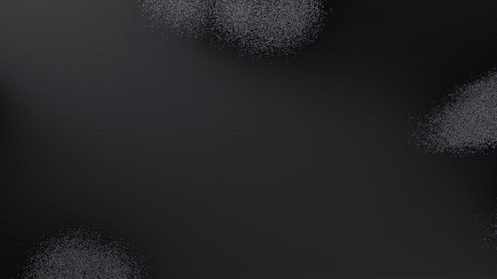](media/intro-ubi-sand-letters.mp4)

Eight million steel grains fly in as five streams and fuse into solid letters (Blender
Geometry Nodes, deterministic, no simulation). Ubi, the studio's creature, then pops in and
hops on each word until it sinks into the floor (LTX video, guided by composited plates).
25 s, 720p.

### Solidify and de-solidify: Abel on deck

From the intro of *The Second Ledger*. A cloud of ash gathers into the painted figure, holds,
then burns back to ash and leaves on the wind. Every grain is born with the colour of the
pixel it replaces, which is why the crossfade is invisible. 8 s, 1080p, cut from the full
intro.

### VFX Studio: a volume element with its alpha

[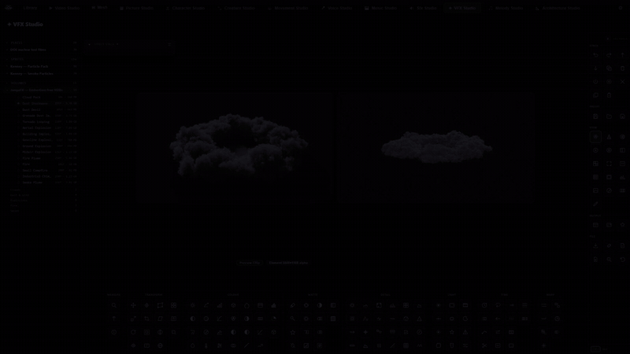](media/vfx-studio-dust-shockwave.mp4)

The VFX Studio tab with a dust shockwave volume selected from the library: the lit preview on
the left, the keyed element with alpha on the right, the tool dock underneath. Screen
recording, 10 s.

## The operator GUI

### Library

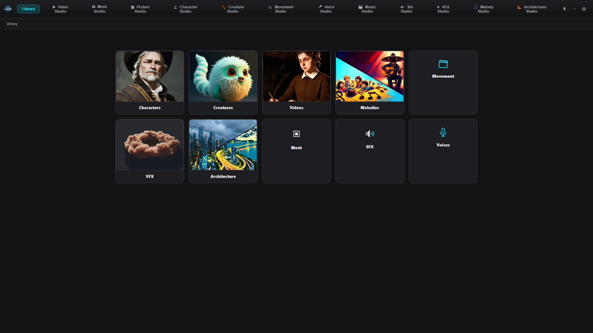

Everything the studios produce lands in one library, by kind.

### A creature, as the studio knows it

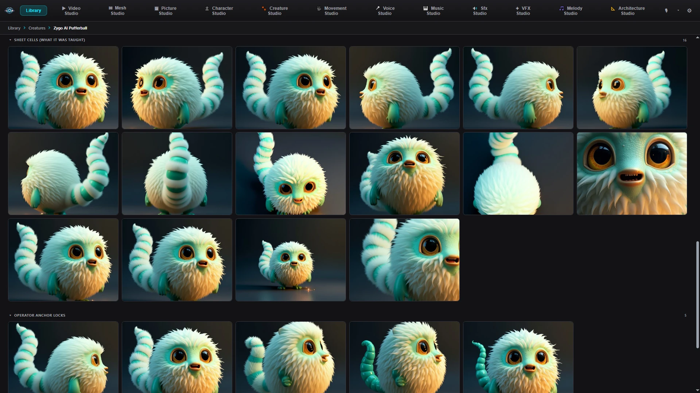

Ubi's sheet cells (what the model was taught) and the operator's anchor locks.

### A character, from every angle

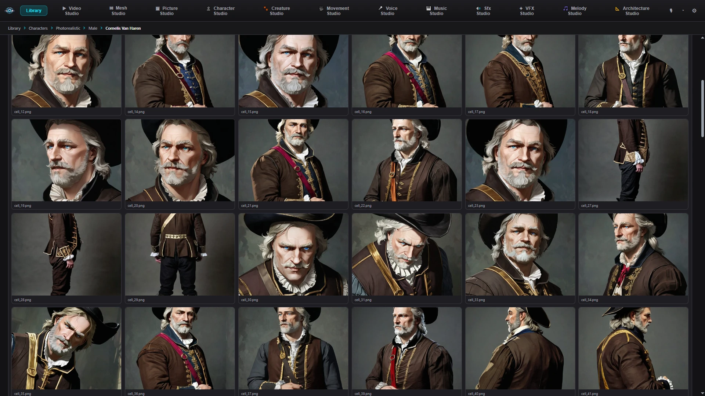

The angle sheet for Cornelis van Haren. Sheets like this are what keep a character the same
person from shot to shot.

### Workflows: 3 documentary runs running simultaneously for testing purposes

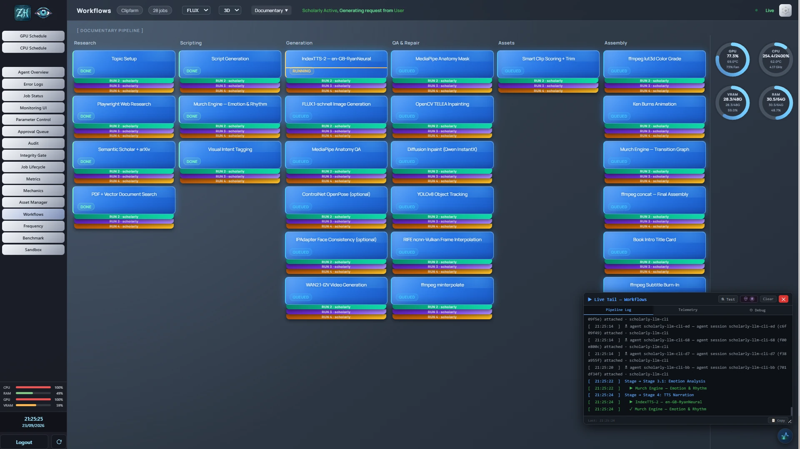

Three documentary runs (runs 2, 3 and 4) moving through the pipeline at the same time, stage
by stage, with GPU, CPU, VRAM and RAM gauges and the live tail.

### Architecture Studio

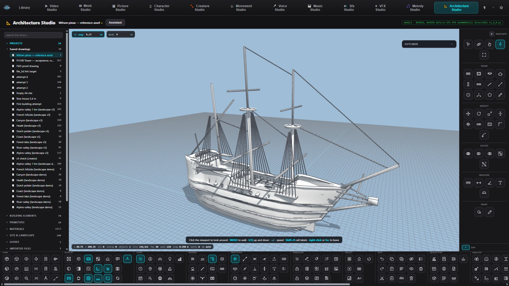

The Architecture Studio viewport and tool dock, here holding the Witsen pinas reference model.

### Creator Nexus

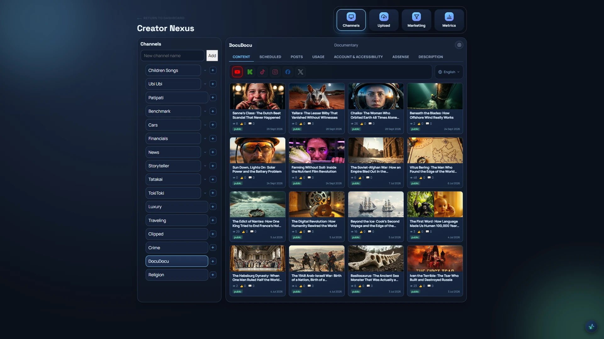

The channel board: one channel's published videos with their platform switches.

### Metrics

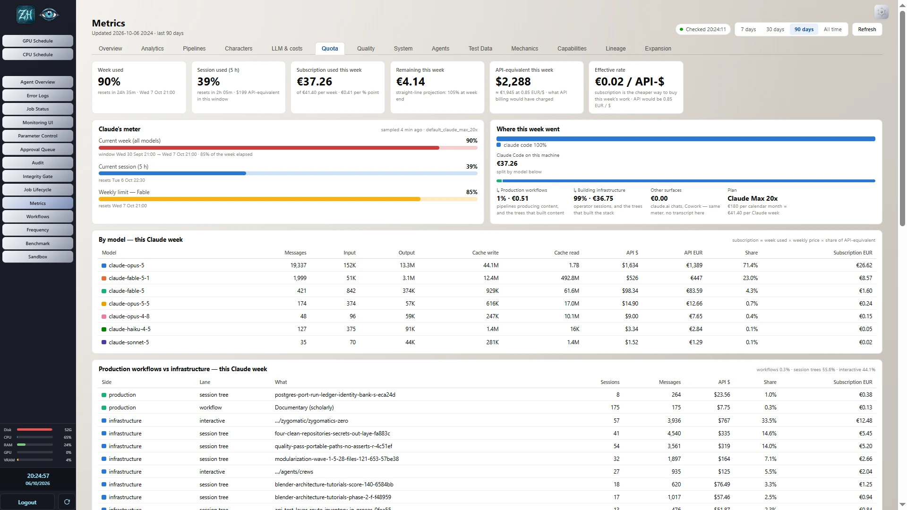

Metrics Quota tab and many more metrics in the other subtabs.

## The studio at a glance

### What runs underneath

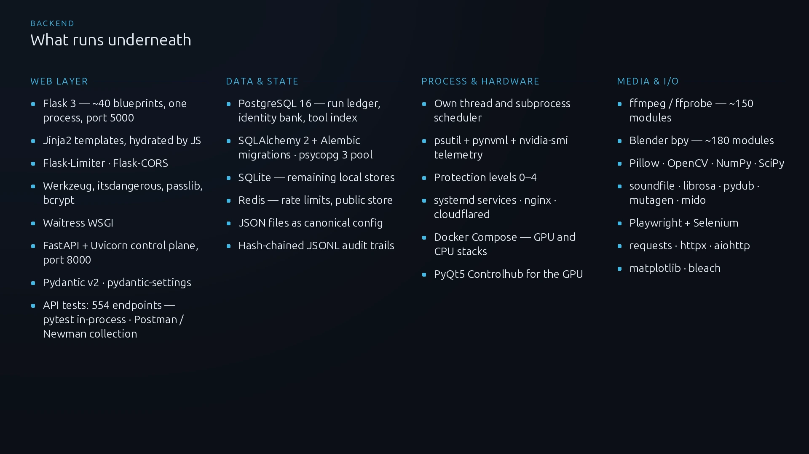

The Backend

### Main tabs, studios and the library

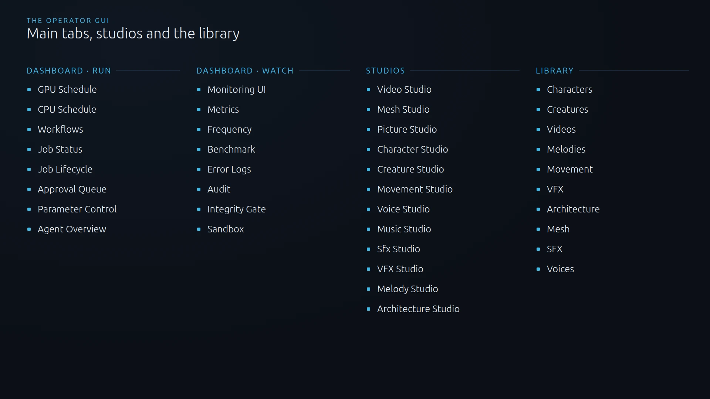

The sixteen dashboard tabs, the twelve studios and the ten kinds of thing the library holds.

### Workflows

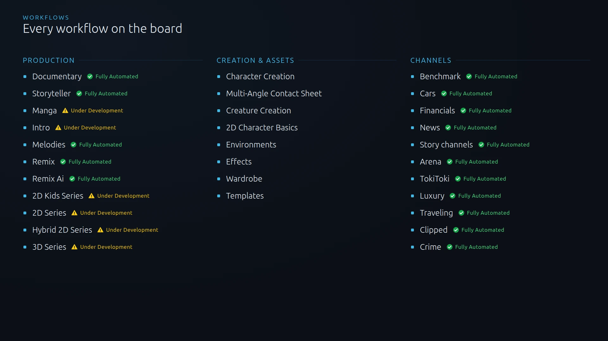

Every workflow on the board. The ones marked **Fully Automated** run on their own schedule,
from topic to finished output, with no operator step in between. (Uploading to pre-selected
platforms included)

The production workflows marked **Under Development** are still being improved. Each workflow
step is proven and works. However, the steps need to be upgraded, refined and tested to get the
desired results before a fully automated claim can be made.
